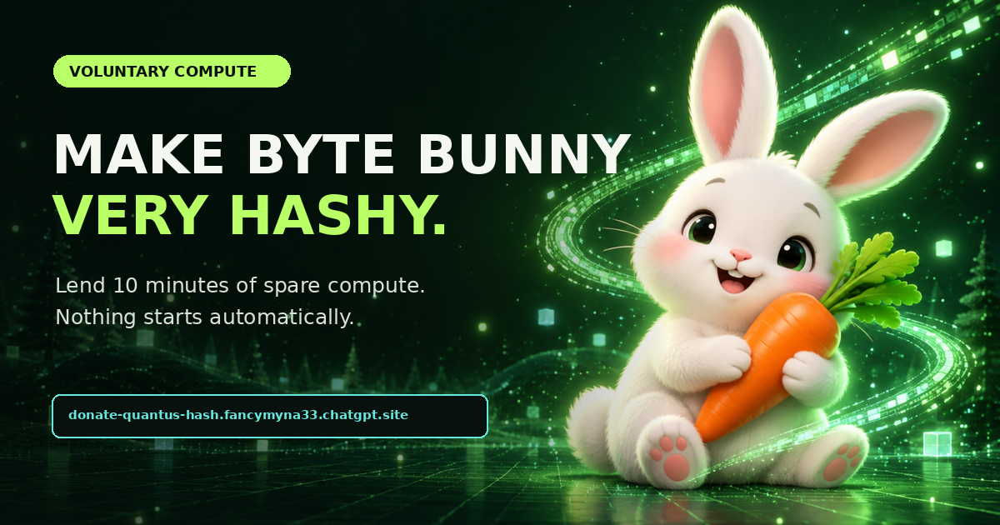

# Byte Bunny Quantus hash drive



Byte Bunny is a transparent, opt-in experiment: volunteers can point spare compute at one public Quantus address and watch the result on the pool. Nothing on the campaign page mines automatically.

**Campaign:** https://donate-quantus-hash.fancymyna33.chatgpt.site  
**Live pool record:** https://www.quantusminer.com/miner?address=qzq2E9QiGfz9q7mbtNA8uWdb8VGApRSY659zprMLUj9FAPZ4Z  
**Payout address:** `qzq2E9QiGfz9q7mbtNA8uWdb8VGApRSY659zprMLUj9FAPZ4Z`

## Give ten minutes

The easiest route works in a browser:

1. Open the [official pool browser miner](https://www.quantusminer.com/mine).
2. Paste the payout address above.
3. Name the worker `bytebunny-yourname`.
4. Pick a comfortable CPU worker count or WebGPU, then press **Start mining**.
5. Press **Stop** whenever you want. Closing the tab also stops it.

The campaign page has a button that copies the address and opens the miner for you.

## NVIDIA CUDA route

The pool publishes a native CUDA miner and its checksums. Download from the [official setup page](https://www.quantusminer.com/native#cuda), verify the file, and run one of these commands from the download directory.

Windows PowerShell:

```powershell
(Get-FileHash .\qpow-cuda-windows-x86_64.exe -Algorithm SHA256).Hash.ToLower()
.\qpow-cuda-windows-x86_64.exe pool ws://quantusminer.com:9901 qzq2E9QiGfz9q7mbtNA8uWdb8VGApRSY659zprMLUj9FAPZ4Z bytebunny-yourname
```

Expected Windows SHA-256 for the current pool download:

```text
23e75ec94886c1f42787404b2387d796672de41150365b44275bb74f908f2a4b
```

Linux:

```bash
sha256sum ./qpow-cuda-linux-x86_64
chmod +x ./qpow-cuda-linux-x86_64
./qpow-cuda-linux-x86_64 pool ws://quantusminer.com:9901 qzq2E9QiGfz9q7mbtNA8uWdb8VGApRSY659zprMLUj9FAPZ4Z bytebunny-yourname
```

Expected Linux SHA-256 for the current pool download:

```text
1daff3cb838188f72a1c74497bb729c10a169e4de3c75df657dc1d7f555f08f5
```

Compare against the pool's live [`SHA256SUMS`](https://www.quantusminer.com/downloads/SHA256SUMS) in case a newer release replaces these files.

## Plain terms

- Mining uses electricity, produces heat, and can make fans loud.
- Use only hardware you own or are authorized to use.
- No private key, seed phrase, payment, or account is needed to contribute.
- The public payout address can receive rewards but cannot authorize spending.
- Browser mining is convenient and usually much slower than the native CUDA miner.
- Worker names and pool activity are public. Use a nickname rather than personal information.
- The carrot counter is playful campaign telemetry. No animal charity receives mining proceeds.

## Show that it worked

Name your worker `bytebunny-yourname`. It should appear on the campaign's live guest board after the pool accepts work. You can also use the [guest hash roll call](https://github.com/ikeago/byte-bunny-quantus/issues/1) to share your device, approximate hashrate, and how long you contributed. Do not post wallet secrets, machine credentials, or identifying details.

## Repository contents

The static campaign is in [`dist/`](dist). It contains no mining engine and makes only a read-only request to the public pool API for campaign telemetry. The native miners and official browser miner are hosted by the pool and are not redistributed here.

